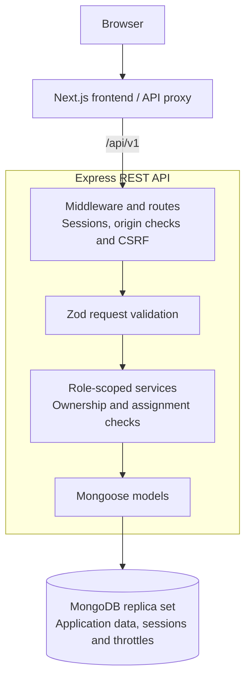

# Doctor Tracker Backend

## Description

A REST API for doctor/patient profiles, registration approvals, assignments, clinical updates and private notes. Role-based access scopes each user's records. Built with Express 5, TypeScript, Mongoose and Zod; MongoDB stores application data, sessions and login throttles.

## Setup guide

Requires **Node.js 24**, **npm 11**, and **MongoDB Atlas or an initialized replica set**. Standalone MongoDB is unsupported. Commands use PowerShell (`cp` replaces `Copy-Item` in Bash).

1. Prepare a development database. For Atlas, create a database user and allow your machine's IP.
2. Install dependencies and copy [.env.example](.env.example):

   ```powershell
   cd doctor-tracker-backend
   npm ci
   Copy-Item .env.example .env
   ```

3. Set these values in `.env`:

   | Variable           | Value                                        |
   | ------------------ | -------------------------------------------- |
   | `MONGODB_URI`      | Your replica-set URI; URL-encode credentials |
   | `MONGODB_DATABASE` | `doctor_tracker_development`                 |
   | `SESSION_SECRET`   | Random secret, at least 32 characters        |
   | `FRONTEND_ORIGIN`  | `http://localhost:3000`                      |
   | `PORT`             | `4000`                                       |

   Generate a secret using the command in `.env.example`. Keep `.env` private; leave `TRUST_PROXY=false` for direct local access.

4. Run `npm run db:check`, then `npm run db:indexes`. Index creation is explicit, never automatic at startup.
5. Provision an administrator with temporary environment variables (password: 12-128 characters):

```powershell
$env:ADMIN_NAME = Read-Host 'Admin name'
$env:ADMIN_EMAIL = Read-Host 'Admin email'
$adminCredential = Get-Credential -UserName $env:ADMIN_EMAIL -Message 'New admin password (12–128 characters)'
try {
    $env:ADMIN_PASSWORD = $adminCredential.GetNetworkCredential().Password
    npm run admin:create
} finally {
    Remove-Item Env:ADMIN_PASSWORD, Env:ADMIN_EMAIL, Env:ADMIN_NAME -ErrorAction SilentlyContinue
    $adminCredential = $null
}
```

6. Run `npm run dev`. Check [localhost:4000/health/ready](http://localhost:4000/health/ready) returns 200, then start the [frontend](../doctor-tracker-frontend/README.md). Doctor/patient registration requires administrator approval.

For compiled execution: `npm run build`, then `npm start`.

## System architecture



Middleware checks sessions, origins and CSRF tokens. Services enforce roles, profile ownership and assignments, then return scoped JSON. Users reference profiles; doctor-patient associations hold assignments and private notes. MongoDB also persists sessions and shared throttles.

## Technical decisions

### 1. Transactions and revisions over last-write-wins updates

Transactions keep approvals, profile linking and assignment-sensitive writes consistent across records. Clinical/note revisions reject stale drafts with `409 REVISION_CONFLICT`, preventing silent overwrites. This requires a replica set and transaction overhead; clients must reload and review conflicts before saving again.

### 2. Persistent sessions over stateless JWTs

MongoDB-backed sessions survive restarts and support immediate logout. Fresh account checks reflect disabled accounts without waiting for token expiry; JWTs would require additional revocation logic. Reusing MongoDB avoids another datastore, but authentication depends on database availability and needs CSRF protection. Sessions expire after eight hours; production cookies require HTTPS.

## API and checks

API prefix: `/api/v1`. Active-admin-only explorer: `/api/v1/docs`. Mutations require a session cookie and `X-CSRF-Token` from `GET /api/v1/auth/csrf`; refresh the token after login.

```powershell
npm run lint
npm run format:check
npm run typecheck
npm test
npm run build
```

Tests use a disposable MongoDB replica set. See [deployment and backups](deploy/README.md).
